<h1 align="center">PaginationKMP by AMA</h1>

<p align="center">
  A Kotlin Multiplatform app showing random users from <a href="https://randomuser.me">randomuser.me</a>, with infinite scroll and offline cache.<br/>
  One Compose Multiplatform UI for Android and iOS, plus a 100% native SwiftUI app (Liquid Glass) sharing the same data and domain layers.<br/>
  Adaptive: phones, tablets and foldables.
</p>

<p align="center">
  
  
  
  
  
  
  <br/>
  
  
  
  
  
</p>

<p align="center">
  
  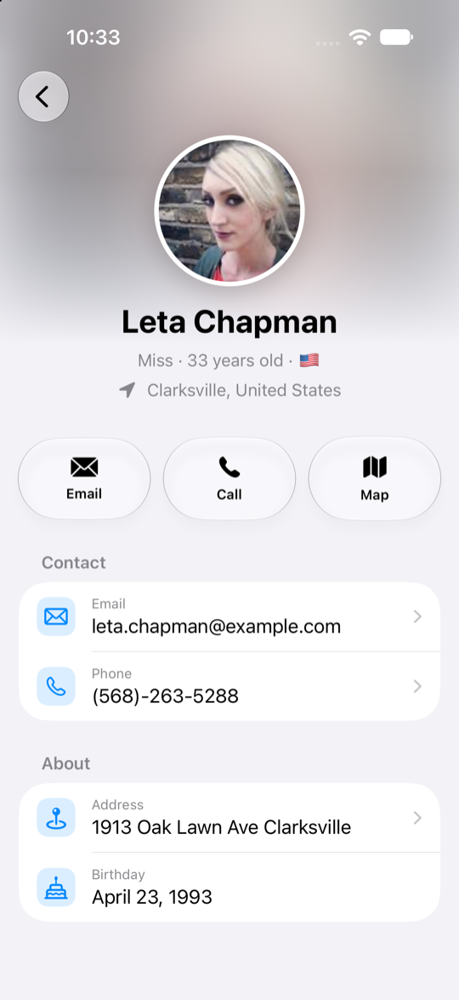
  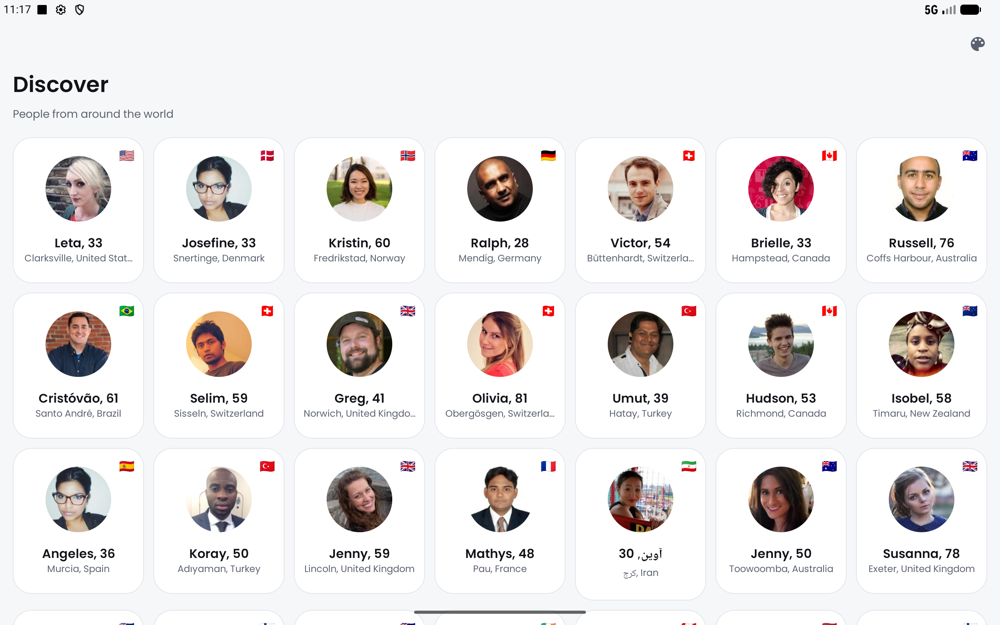
</p>

A 100% native Android mirror exists: [PaginationDemo](https://github.com/AntoineMarchaud/PaginationDemo) (Jetpack Compose + Hilt), with the same architecture, tests and look.

## Three apps, one shared core

| App | UI | Shares with Kotlin |
|---|---|---|
| `androidApp` | Compose Multiplatform (Material 3, "Material You" option) | everything: data, domain, ViewModels, screens |
| `iosApp` | Compose Multiplatform | everything: data, domain, ViewModels, screens |
| `iosAppNative` | **SwiftUI**, iOS 26 Liquid Glass | **data + domain only** (use cases), through the `Shared` framework |

The native iOS app follows the most common KMP pattern (the one used by Google Docs): Kotlin owns data access, cache and pagination; Swift owns its ViewModels, mapping and navigation. Sharing the ViewModels too remains a possible next step.

## Screenshots

**Android (phone)**

| List | Detail | List (dark) | Detail (dark) |
|:---:|:---:|:---:|:---:|
|  |  |  |  |

**"Material You" (Android 12+)**

| Option | Dynamic colors |
|:---:|:---:|
| 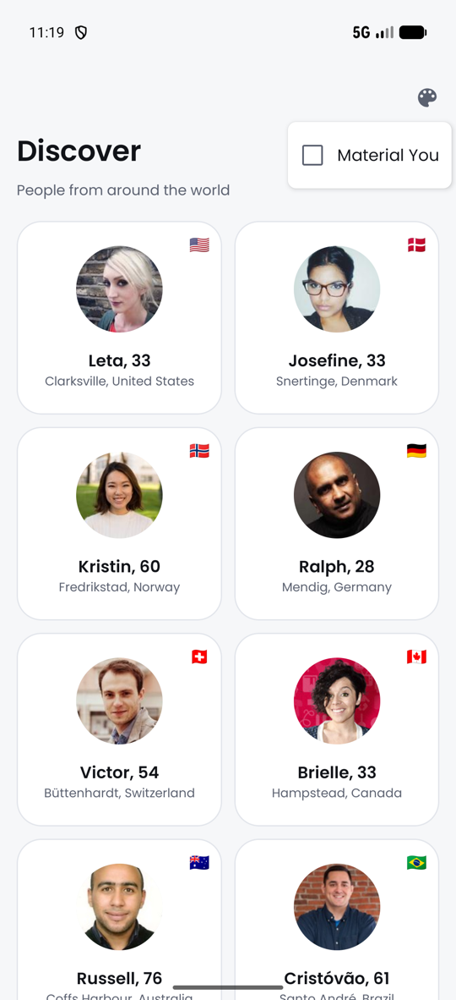 | 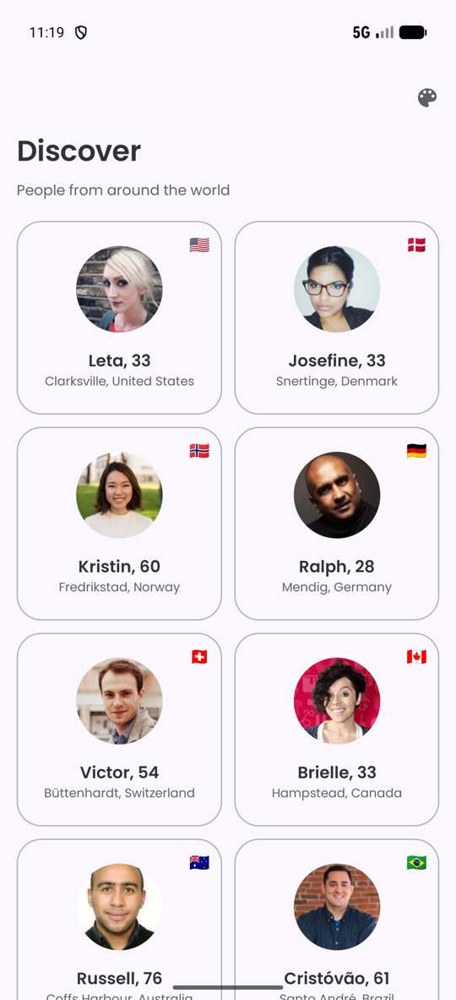 |

**Tablet and foldable**

| Tablet (landscape) | Tablet detail |
|:---:|:---:|
|  | 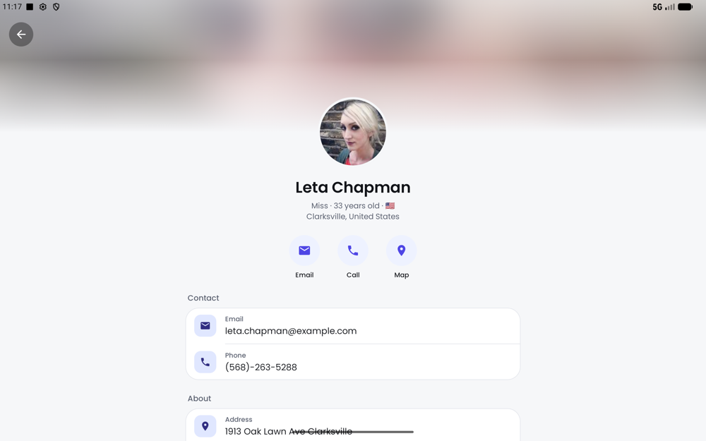 |

| Foldable closed | Foldable open | Foldable open, detail |
|:---:|:---:|:---:|
| 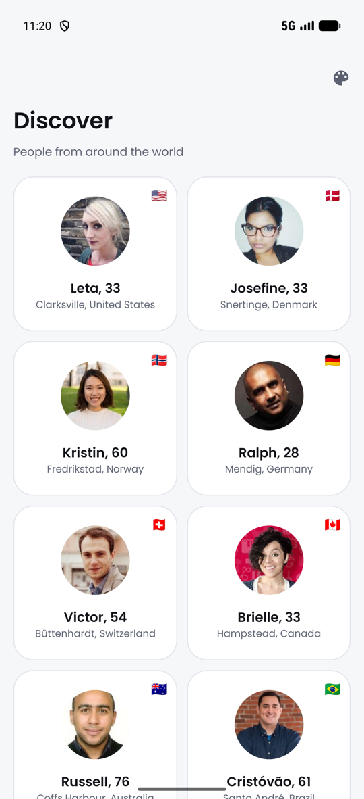 | 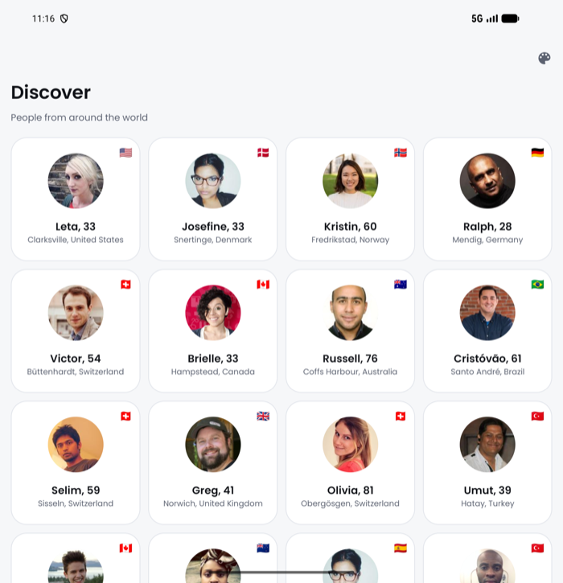 | 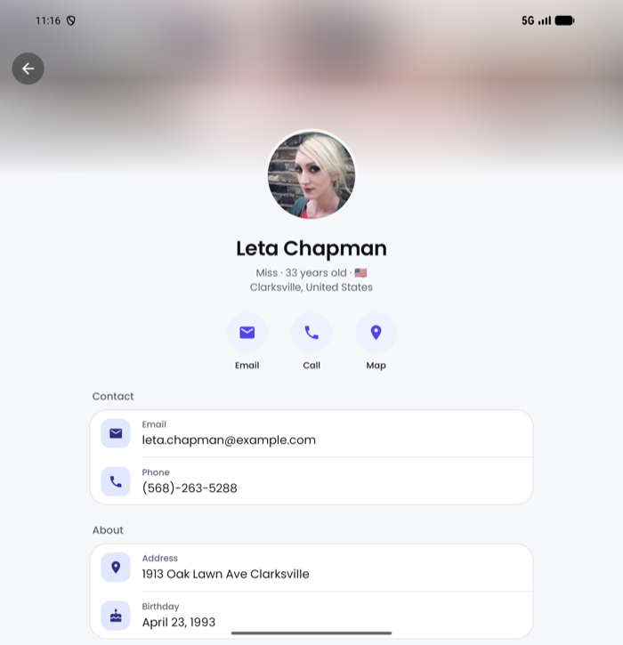 |

**iOS (Compose Multiplatform)**

| List | List (dark) |
|:---:|:---:|
|  | 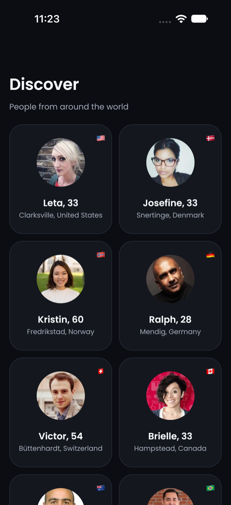 |

**iOS native (SwiftUI, Liquid Glass)**

| List | Detail | List (dark) | Detail (dark) |
|:---:|:---:|:---:|:---:|
| 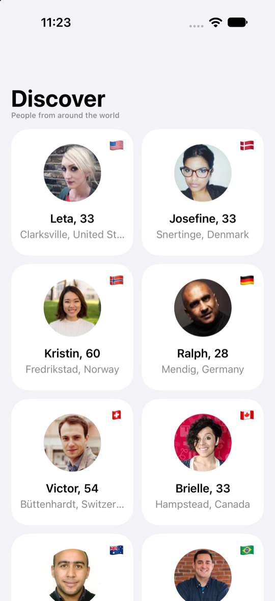 |  | 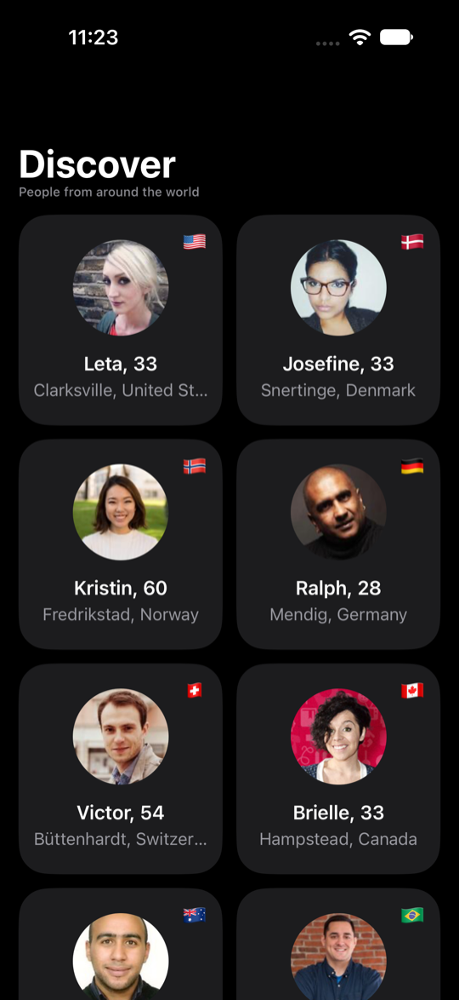 | 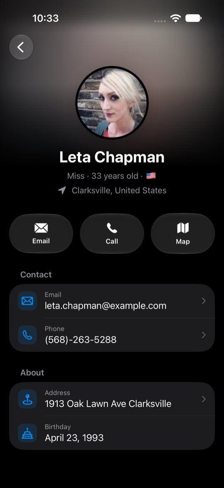 |

| iPad | iPad detail |
|:---:|:---:|
| 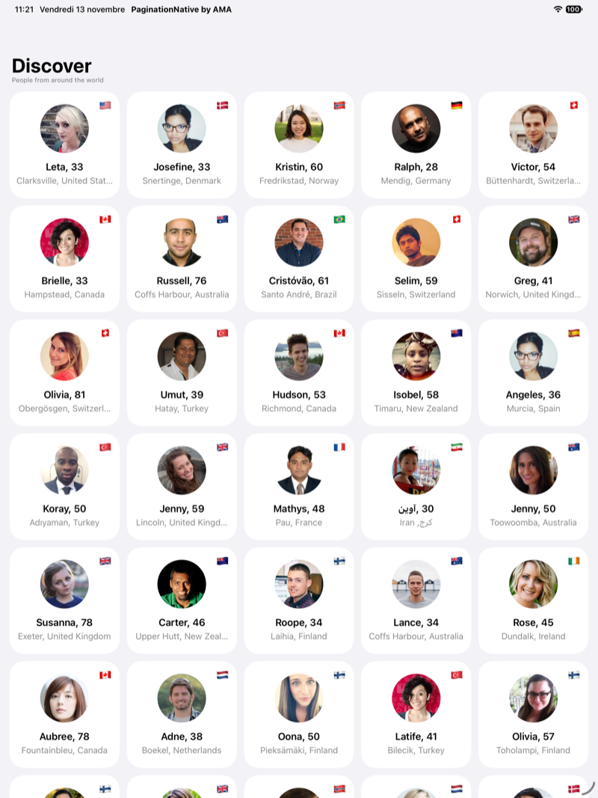 | 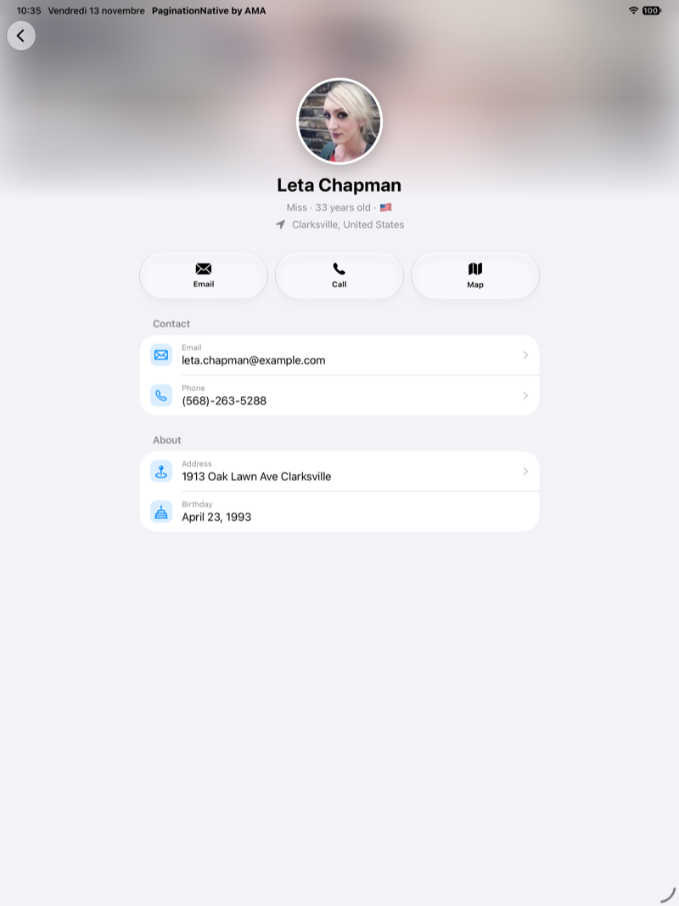 |

## Tech Stack

- Kotlin 2.4, KSP, Gradle 9.9 / AGP 9.5, version catalog (TOML)
- Compose Multiplatform 1.12 (UI shared between Android and iOS), Material 3, Navigation Compose
- SwiftUI (iOS 26, Liquid Glass), Observation, Swift Testing
- Koin
- Room (KMP) + Paging 3 (`RemoteMediator`: network + local cache)
- Ktor 3 + Kotlinx Serialization
- DataStore Preferences (KMP) for the "Material You" option
- Coil 3
- MVI + Clean Architecture
- Unit tests in `commonTest`, run on Android (host tests), JVM and iOS simulator: kotlin-test, kotlinx-coroutines-test, Turbine, Ktor MockEngine, paging-testing; Swift Testing for the native iOS app

## Project Structure

```
PaginationDemoMultiPlatform/
├── androidApp/     # Android application (entry point, app icon)
├── iosApp/         # iOS application hosting the Compose UI (scheme "iosApp")
├── iosAppNative/   # Native SwiftUI iOS application (scheme "iosAppNative") + Swift tests
├── composeApp/     # Shared Compose app: navigation, theme, iOS framework "ComposeApp"
├── iosShared/      # iOS framework "Shared" for the native app: domain exported, data embedded,
│                   #   Paging adapter (PagingItems) and Flow bridge (Watcher) for Swift
├── ui/             # MVI ViewModels, contracts, Compose screens and previews
├── domain/         # Use cases, repository interfaces, models (pure Kotlin)
└── data/           # Repositories, Ktor API, Room database, RemoteMediator, settings
```

## Architecture (MVI)

Each screen has a contract:

- **State**: an immutable data class exposed as a `StateFlow`;
- **Action**: everything the user does, sent with `viewModel.onAction(...)`;
- **Event**: one-shot effects (navigation, refresh, opening a link), sent through a `Channel` and collected with `ObserveAsEvents`.

Navigation decisions are taken by the ViewModels, so they are unit tested.

In the native iOS app, Swift `@Observable` ViewModels call the use cases directly: `GetOneUserUseCase` is a Kotlin `suspend` function used with `async/await`, and the paged users go through `PagingItems`, which presents `Flow<PagingData>` as an observable list (placeholders included, like `LazyPagingItems`).

## Features

- Infinite scroll with a local Room cache (works offline)
- Pull-to-refresh
- List to detail transition: shared avatar (Compose), zoom transition (SwiftUI)
- Detail screen: blurred header, Email / Call / Map quick actions (maps open the user's city: randomuser.me streets, regions and coordinates are random)
- Light and dark themes; **"Material You" option** on Android 12+ (system dynamic colors, remembered between launches)
- Phones, tablets and foldables: adaptive grid, detail content centered on large screens, no state lost on rotation or fold
- Skeleton loading, full-screen and inline error states with readable messages (no internet, timeout, server error…)
- Zero compiler warnings (Kotlin and Swift)

## Run

- **Android**: run the `androidApp` configuration in Android Studio.
- **iOS (Compose)**: open `iosApp/iosApp.xcodeproj` in Xcode, pick an iOS 26 simulator, then Run (⌘R). Xcode builds the Kotlin framework with Gradle.
- **iOS (native SwiftUI)**: open `iosAppNative/iosAppNative.xcodeproj`, scheme `iosAppNative`, then Run. The app is named "PaginationNative by AMA".

## Tests

```bash
# Kotlin: domain, data, ui, iosShared (Android host, JVM and iOS simulator)
./gradlew allTests :data:testAndroidHostTest :ui:testAndroidHostTest

# Swift: native iOS app
xcodebuild test -project iosAppNative/iosAppNative.xcodeproj -scheme iosAppNative \
  -destination 'platform=iOS Simulator,name=iPhone 18 Pro'
```

## What's missing

- Code quality: KtLint, Detekt, SwiftLint
- UI tests
