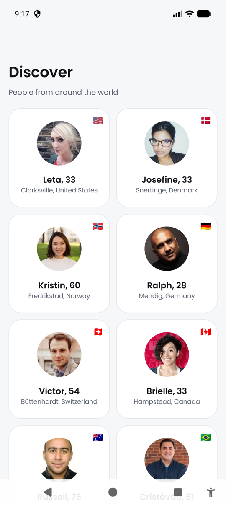
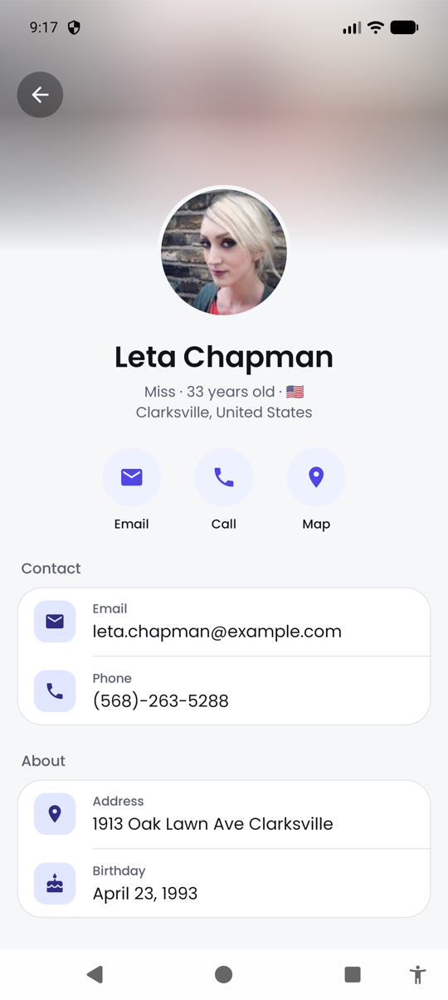
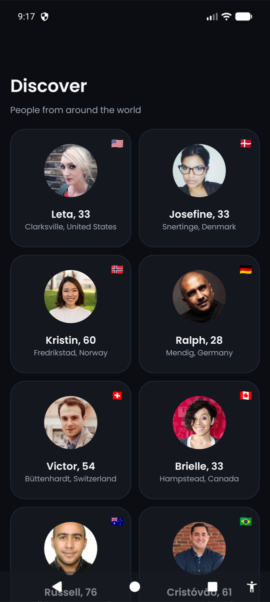
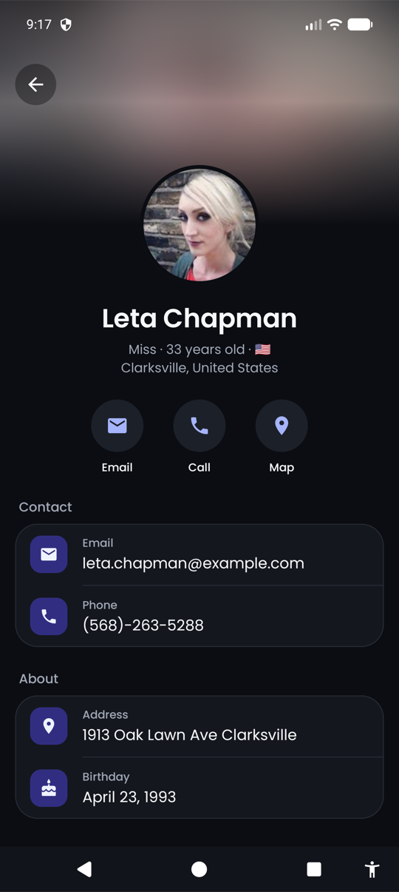
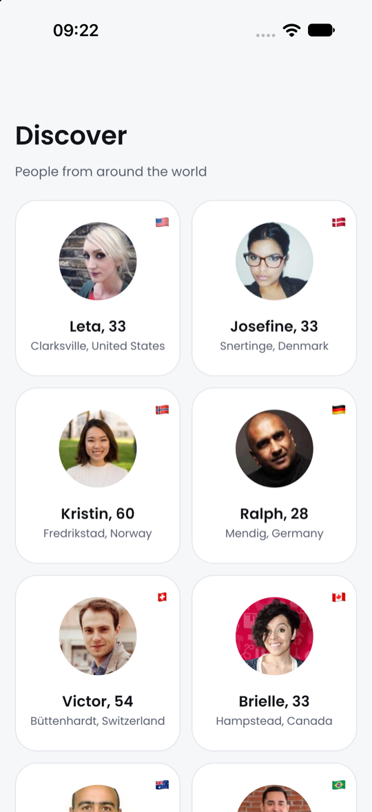

# PaginationKMP by AMA — Kotlin Multiplatform

A Kotlin Multiplatform app (Android + iOS) with a UI shared in Compose Multiplatform. It displays random users from [randomuser.me](https://randomuser.me) with infinite scroll and offline cache.

A 100% native Android mirror exists: [PaginationDemo](https://github.com/AntoineMarchaud/PaginationDemo) (Jetpack Compose + Hilt), with the same architecture, tests and look.

## Screenshots

**Android**

| List | Detail | List (dark) | Detail (dark) |
|:---:|:---:|:---:|:---:|
|  |  |  |  |

**iOS**

| List | List (dark) |
|:---:|:---:|
|  |  |

## Tech Stack

- Kotlin 2.4, KSP, Gradle 9.9 / AGP 9.5, version catalog (TOML)
- Compose Multiplatform 1.12 (UI shared between Android and iOS), Material 3, Navigation Compose
- Koin
- Room (KMP) + Paging 3 (`RemoteMediator`: network + local cache)
- Ktor 3 + Kotlinx Serialization
- Coil 3
- MVI + Clean Architecture
- Unit tests in `commonTest`, run on Android (host tests), JVM and iOS simulator: kotlin-test, kotlinx-coroutines-test, Turbine, Ktor MockEngine, paging-testing

## Project Structure

```
PaginationDemoMultiPlatform/
├── androidApp/   # Android application (entry point, app icon)
├── iosApp/       # iOS application (Xcode project, scheme "iosApp") hosting the Compose UI
├── composeApp/   # Shared app: navigation, theme, iOS framework "ComposeApp"
├── ui/           # MVI ViewModels, contracts, Compose screens and previews
├── domain/       # Use cases, repository interfaces, models (pure Kotlin)
└── data/         # Repositories, Ktor API, Room database, RemoteMediator
```

## Architecture (MVI)

Each screen has a contract:

- **State**: an immutable data class exposed as a `StateFlow`;
- **Action**: everything the user does, sent with `viewModel.onAction(...)`;
- **Event**: one-shot effects (navigation, refresh, opening a link), sent through a `Channel` and collected with `ObserveAsEvents`.

Navigation decisions are taken by the ViewModels, so they are unit tested.

## Features

- Infinite scroll with a local Room cache (works offline)
- Pull-to-refresh (the large "Discover" title expands first)
- Avatar shared-element transition from the list to the detail screen
- Detail screen: blurred parallax header, Email / Call / Map quick actions (platform `UriHandler`)
- Light and dark themes, Poppins typography
- Skeleton loading, full-screen and inline error states with readable messages (no internet, timeout, server error…)
- Zero compiler warnings

## Run

- **Android**: run the `androidApp` configuration in Android Studio.
- **iOS**: open `iosApp/iosApp.xcodeproj` in Xcode, pick an iPhone simulator, then Run (⌘R). Xcode builds the Kotlin framework with Gradle.

## Tests

```bash
./gradlew allTests :data:testAndroidHostTest :ui:testAndroidHostTest
```

## What's missing

- Code quality: KtLint, Detekt
- UI tests
